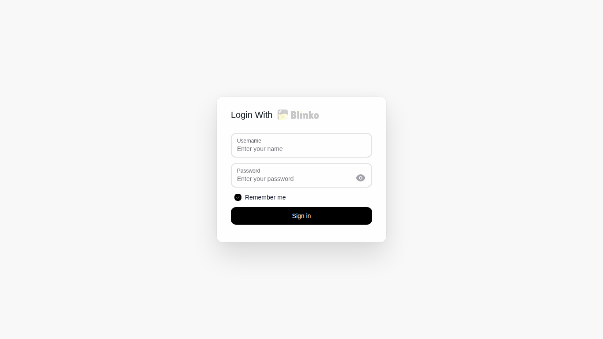
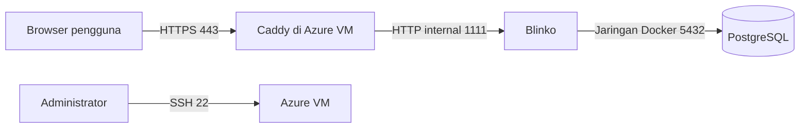

<p align="center">
  
</p>

<h1 align="center">Blinko</h1>

<p align="center">Penerapan Blinko pada Azure Virtual Machine</p>

<p align="center">
  
  
  
</p>

<p align="center">
  <a href="https://blinko-kdjk.australiaeast.cloudapp.azure.com/">Buka aplikasi</a> •
  <a href="https://github.com/blinkospace/blinko">Repositori Blinko</a> •
  <a href="https://docs.blinko.space/">Dokumentasi Blinko</a>
</p>

Proyek kelompok mata kuliah KDJK: memasang aplikasi catatan [Blinko](https://github.com/blinkospace/blinko) pada Azure Virtual Machine agar dapat diakses melalui internet. Repositori ini mendokumentasikan **deployment** dan berisi konfigurasi Docker Compose serta Caddy yang digunakan. Kode aplikasi Blinko tetap berasal dari proyek resminya melalui image Docker `blinkospace/blinko`.

## Anggota kelompok

| NIM | Nama |
| --- | --- |
| M0403241025 | ALDEN NARA NABIHA KAYANA HYLMI |
| M0403241026 | Taufiq Sadri |
| M0403241029 | Azka Julian Putra Wahyudi |
| M0403241030 | JEREMY TJAHJANA |
| M0403241032 | NASYWA AZZAHRA NAADHIRAH |

## Sekilas tentang Blinko

Blinko adalah aplikasi catatan yang dapat di-host sendiri. Pengguna dapat membuat catatan dan daftar tugas, lalu memakai AI untuk bertanya berdasarkan catatannya. Pada proyek ini, aplikasi dijalankan bersama PostgreSQL sebagai database dan Caddy sebagai reverse proxy HTTPS.

Alamat aplikasi: **https://blinko-kdjk.australiaeast.cloudapp.azure.com/**



## Spesifikasi dan arsitektur

| Komponen | Konfigurasi yang digunakan |
| --- | --- |
| Cloud | Azure for Students, region Australia East |
| Resource group | `jeremyauto_group` |
| VM | `blinklocal`, Standard B2als v2, 2 vCPU, 4 GiB RAM |
| Sistem operasi | Ubuntu Server 24.04 LTS x64; saat diperiksa: Ubuntu 24.04.5 LTS |
| Akses administrasi | SSH dengan key pair, pengguna `jeremytj` |
| Public IP | `20.53.245.48`, assignment Static |
| DNS | `blinko-kdjk.australiaeast.cloudapp.azure.com` |
| Port masuk | TCP 22 (SSH), 80 (HTTP), 443 (HTTPS) |
| Aplikasi | Docker Compose: Blinko, PostgreSQL 14, Caddy 2 |



Port 1111 dan 5432 hanya dipakai antarkontainer; keduanya tidak dipublikasikan sebagai port masuk dari internet. Caddy menerima permintaan pada port 80 dan 443, lalu meneruskannya ke Blinko. Volume Docker menyimpan data database, data Blinko, dan data Caddy agar tetap ada ketika kontainer dibuat ulang.

## Langkah instalasi yang dilakukan

### 1. Membuat Azure VM

Di Azure Portal dibuat VM `blinklocal` pada resource group `jeremyauto_group` di Australia East. Image yang dipilih adalah Ubuntu Server 24.04 LTS x64, ukuran Standard B2als v2, autentikasi SSH public key, tanpa Azure Spot dan tanpa redundansi infrastruktur. Pada pembuatan VM, port 22, 80, dan 443 diizinkan. Public IP dibuat dan kemudian diberi label DNS `blinko-kdjk` dengan assignment **Static**.

> Port SSH 22 terbuka untuk koneksi administrasi. Untuk penggunaan jangka panjang, aturan akses SSH sebaiknya dibatasi ke IP administrator dan orang yang memang diberi izin.

### 2. Masuk ke VM melalui SSH

Azure menyediakan private key `blinklocal_key.pem`. Pada laptop Linux, izin file key dibatasi agar SSH mau menggunakannya:

```bash
chmod 600 ~/Downloads/blinklocal_key.pem
ssh -i ~/Downloads/blinklocal_key.pem jeremytj@20.53.245.48
```

Private key tersebut **tidak** dimasukkan ke repositori ini.

### 3. Memasang Docker dan Docker Compose

Di VM Ubuntu, Docker dan plugin Compose dipasang agar aplikasi dapat dijalankan sebagai beberapa kontainer:

```bash
sudo apt update
sudo apt install -y docker.io docker-compose-v2
sudo docker compose version
```

Versi yang diperiksa pada VM: Docker `29.1.3` dan Docker Compose `2.40.3`.

### 4. Memeriksa DNS

Setelah label DNS disimpan pada resource Public IP di Azure, alamat domain diperiksa dari VM:

```bash
getent ahostsv4 blinko-kdjk.australiaeast.cloudapp.azure.com
```

Hasilnya mengarah ke public IP `20.53.245.48`.

### 5. Membuat variabel rahasia

Folder `~/blinko` dibuat pada VM. File `.env` menyimpan password PostgreSQL, secret aplikasi, dan nama host. Password dan secret dibuat acak, lalu izin file dibatasi:

```bash
mkdir -p ~/blinko
cd ~/blinko
printf 'POSTGRES_PASSWORD=%s\nNEXTAUTH_SECRET=%s\nBLINKO_HOST=%s\n' \
  "$(openssl rand -hex 24)" \
  "$(openssl rand -hex 32)" \
  'blinko-kdjk.australiaeast.cloudapp.azure.com' > .env
chmod 600 .env
```

Perintah ini untuk **instalasi baru**. Jangan menimpa `.env` pada instalasi yang sudah memiliki database. File asli `.env` tetap berada di VM; repositori hanya menyediakan [`.env.example`](.env.example) tanpa rahasia.

### 6. Menyiapkan Docker Compose dan Caddy

File [`compose.yaml`](compose.yaml) berisi tiga layanan:

1. `db`: PostgreSQL 14 dengan database dan user bernama `blinko`.
2. `blinko`: image `blinkospace/blinko:latest`, terhubung ke database melalui nama layanan `db`.
3. `caddy`: menerima HTTP/HTTPS dan meneruskan permintaan ke Blinko.

File [`Caddyfile`](Caddyfile) menentukan domain dan tujuan reverse proxy `blinko:1111`. Caddy menangani HTTPS pada domain tersebut. Di Compose, layanan Blinko menunggu database mencapai status *healthy* sebelum berjalan.

### 7. Menjalankan dan memeriksa layanan

Dari folder `~/blinko` pada VM:

```bash
sudo docker compose up -d
sudo docker compose ps
```

Pada pemeriksaan terakhir, ketiga kontainer berstatus **Up** dan PostgreSQL **healthy**. Caddy membuka port 80/443, sedangkan port aplikasi dan database tetap berada di jaringan Docker. Situs diakses melalui URL HTTPS di atas dan merespons `HTTP/2 200`.

### 8. Membuat akun dan mencoba fitur AI

Akun pertama didaftarkan melalui halaman Blinko dan menjadi `superadmin`. Pengguna lain dapat dibuat sebagai akun biasa melalui **Settings → User List → Create User**.

Pada **Settings → AI**, penyedia OpenAI dan API key dikonfigurasi. Saat diperiksa, model chat utama yang dipilih adalah `gpt-4.1-nano` dan model embedding adalah `text-embedding-3-small`. Chat AI diuji melalui halaman `/ai`. API key dan token pengguna tidak dicantumkan dalam laporan ini.

Pemakaian OpenAI API menggunakan kuota akun OpenAI yang dikonfigurasi pada Blinko; biaya ini terpisah dari biaya Azure VM.

## Cara pemakaian

1. Buka alamat Blinko melalui browser dan masuk menggunakan akun masing-masing.
2. Buat catatan melalui menu **Blinko** atau **Notes**; gunakan **Todo** untuk tugas.
3. Buka menu **AI** untuk mengajukan pertanyaan tentang catatan. Model embedding membantu pencarian konteks dari catatan.
4. Administrator mengelola akun di **Settings → User List** dan model di **Settings → AI**.

## Pengujian

| Pemeriksaan | Hasil |
| --- | --- |
| Resolusi DNS | Domain mengarah ke `20.53.245.48` |
| SSH | Koneksi ke VM berhasil setelah izin private key menjadi `600` |
| Docker Compose | Layanan `db`, `blinko`, dan `caddy` berstatus Up |
| Database | Healthcheck PostgreSQL berstatus healthy |
| HTTPS | Halaman publik merespons `HTTP/2 200` melalui Caddy |
| Aplikasi | Halaman login terbuka; akun pertama berhasil digunakan |
| AI | Halaman chat AI dapat digunakan setelah model dikonfigurasi |

## Pemeliharaan dan biaya

Perintah berikut dapat digunakan untuk memeriksa layanan apabila ada masalah:

```bash
cd ~/blinko
sudo docker compose ps
sudo docker compose logs --tail=100 blinko
sudo docker compose logs --tail=100 caddy
```

Karena proyek memakai Azure for Students, VM dapat dihentikan dari Azure Portal dengan memilih **Stop** dan memastikan statusnya **Stopped (deallocated)** saat tidak diperlukan. Ini menghentikan biaya komputasi VM, meskipun disk dan sumber daya lain mungkin tetap dikenai biaya. Pengaturan auto-shutdown belum diaktifkan pada pembuatan VM, sehingga penghentian perlu dilakukan secara manual.

Data aplikasi berada pada volume Docker. Penghapusan VM, disk, atau volume dapat menghilangkan data; sebelum melakukan perubahan besar, database dan data aplikasi perlu dicadangkan. Pada konfigurasi ini `restart: unless-stopped` membuat kontainer berjalan kembali ketika Docker/VM dihidupkan.

## Pembahasan

**Kelebihan:** aplikasi dapat diakses dari perangkat lain melalui HTTPS, data utama tersimpan di VM yang dikelola sendiri, dan Docker Compose memisahkan aplikasi, database, serta reverse proxy sehingga konfigurasi mudah dijelaskan dan dijalankan ulang.

**Keterbatasan:** ketersediaan bergantung pada VM dan kredit Azure. VM ini tidak memakai redundansi atau backup otomatis. Pengelola juga bertanggung jawab menjaga pembaruan image, akses SSH, API key, dan pencadangan data. OpenAI API memakai kuota tersendiri.

## Keamanan berkas repositori

File `.env`, private SSH key, dump database, API key OpenAI, dan token akses Blinko tidak boleh diunggah ke GitHub. Aturan [`.gitignore`](.gitignore) membantu mencegah berkas tersebut ikut ter-commit. Sebelum mengunggah screenshot, periksa kembali apakah ada password, token, alamat email pribadi, atau informasi lain yang tidak ingin dipublikasikan.

## Referensi

- [Repositori resmi Blinko](https://github.com/blinkospace/blinko)
- [Dokumentasi Blinko: pengaturan AI](https://docs.blinko.space/en/how-to-use/ai/ai-setting)
- [Dokumentasi Blinko: AI chat](https://docs.blinko.space/en/how-to-use/ai/ai-chat)
- [Dokumentasi Docker Compose](https://docs.docker.com/compose/)
- [Dokumentasi Caddy reverse proxy](https://caddyserver.com/docs/caddyfile/directives/reverse_proxy)
- [Dokumentasi Azure Public IP](https://learn.microsoft.com/en-us/azure/virtual-network/ip-services/public-ip-addresses)
- [Contoh format laporan proyek KDJK](https://github.com/Calvinismee/Proyek-KDJK-Kel4-P3)
